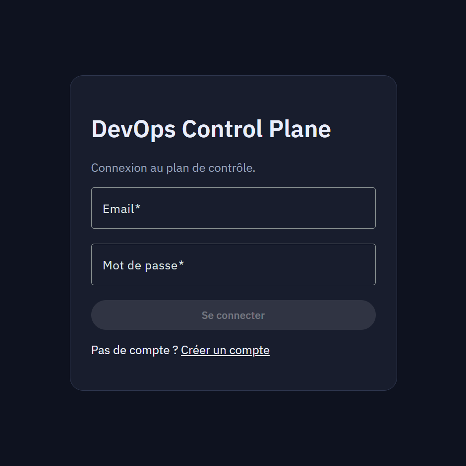
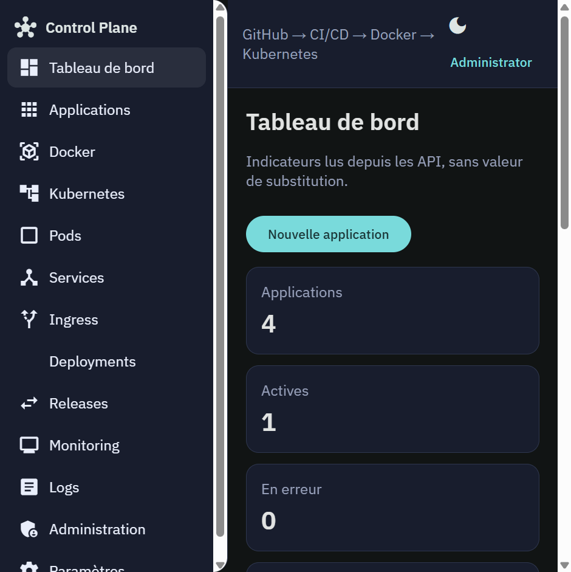
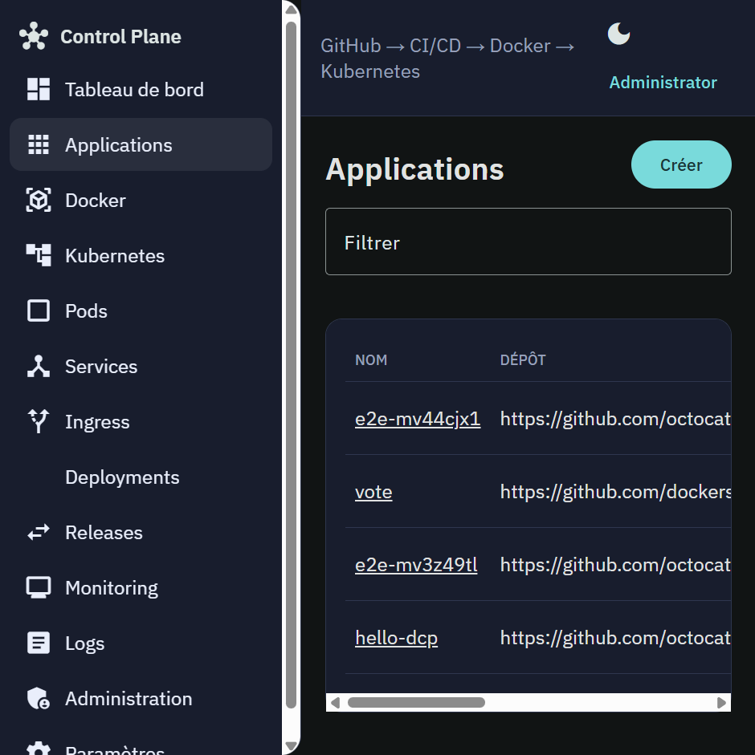
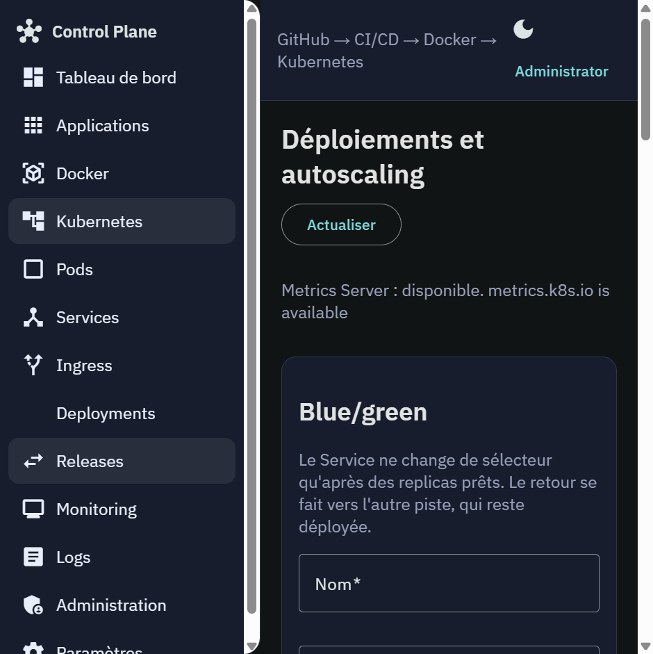
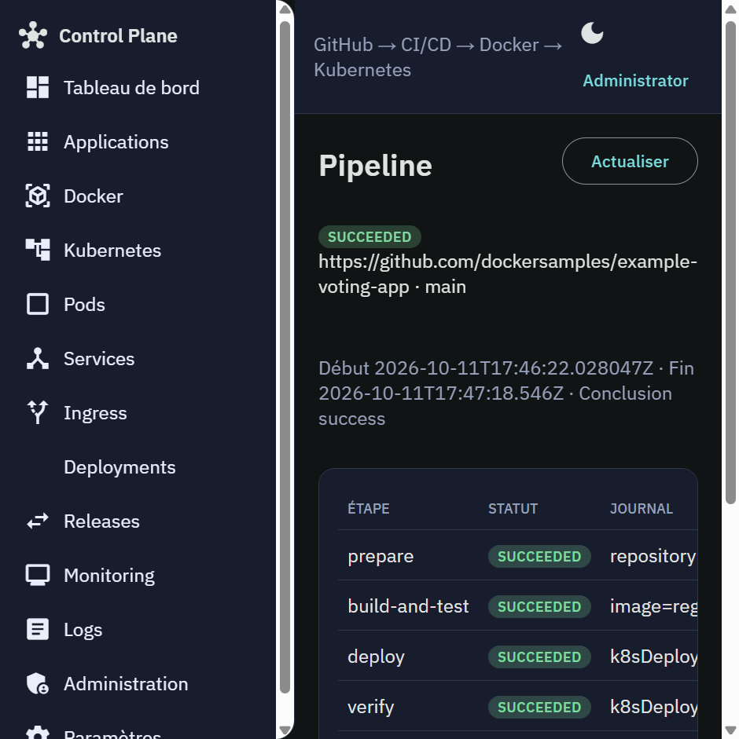
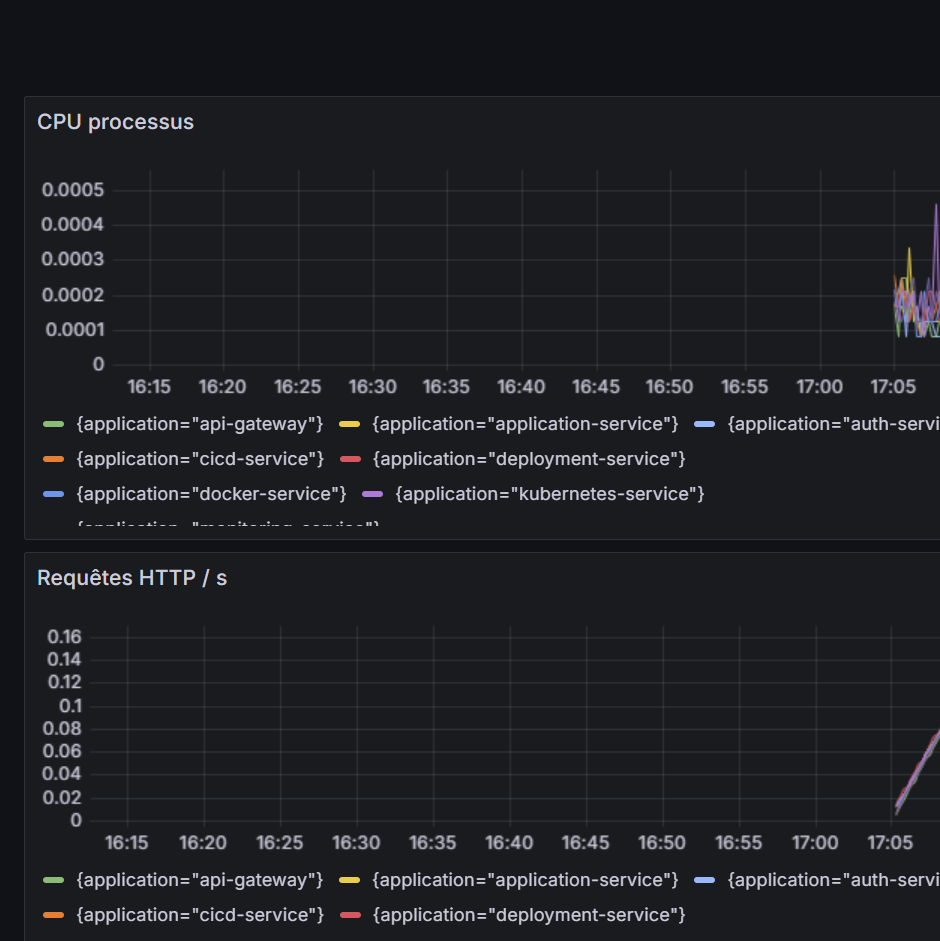

# DevOps Control Plane

Plan de contrôle local pour construire une image, la publier et la déployer sur Kubernetes. Le dépôt contient huit microservices Spring Boot, une interface Angular, Docker Compose et les manifestes Kubernetes.

## Architecture

Le navigateur parle à Angular. Angular appelle la passerelle. La passerelle vérifie le JWT et route vers le service concerné. MySQL est la base partagée. Prometheus scrape les métriques Actuator. Grafana les affiche.

```text
Angular
  └─ api-gateway
       ├─ auth-service            comptes, JWT, rôles
       ├─ application-service     fiches application
       ├─ docker-service          clone Git, build, registre
       ├─ kubernetes-service      Pods, releases, HPA
       ├─ deployment-service      orchestration build puis déploiement
       ├─ cicd-service            pipelines
       └─ monitoring-service      Prometheus et alertes
```

Un cluster kind nommé `dcp` se raccorde à `kubernetes-service` par `docker-compose.k8s.yml`. Le kubeconfig de ce raccordement reste sur la machine : il n'est pas versionné.

## Fonctionnalités

- Connexion, rôles et administration des comptes.
- Fiche application liée à un dépôt GitHub HTTPS.
- Pipeline local : clone, tests si un `pom.xml` ou un `package.json` est à la racine, image Docker, poussée vers le registre, déploiement Kubernetes.
- Blue/green : le Service ne change de sélecteur qu'une fois les Pods prêts.
- Canary par HTTPRoute Gateway API, poids 10, 25, 50 ou 100. Le trafic n'est marqué appliqué que si les Pods sont prêts et que le Gateway accepte la route.
- Rollback d'une révision de Deployment, réservé à un administrateur. Ce n'est pas le retour à l'image précédente d'une fiche application.
- Horizontal Pod Autoscaler lorsque Metrics Server répond.
- Tableaux Prometheus et Grafana.

## Technologies

| Élément | Version |
| --- | --- |
| Java | 21 |
| Spring Boot | 3.5.15 |
| Spring Cloud | 2025.0.3 |
| Angular | 21 |
| MySQL | 8 |
| Docker Compose | fichiers à la racine |
| Kubernetes | manifestes dans `infrastructure/kubernetes`, cluster kind 0.27 |
| Gateway API | CRD v1.6.3, contrôleur Traefik 3.3 |
| Prometheus, Grafana | inclus dans Compose |

## Installation

Prérequis : Java 21, Maven 3.9, Node.js 24, Docker Desktop.

```powershell
Copy-Item .env.example .env
.\scripts\start-local.ps1
cd frontend
npm install
npx ng serve --host 127.0.0.1 --port 4200
```

L'interface est sur `http://127.0.0.1:4200`. Le script copie `.env.example` vers `.env` s'il manque, construit les JAR, puis lance Compose. S'il trouve Maven dans `.tools/apache-maven-3.9.11`, il l'utilise. Sinon il appelle `mvn` du PATH. Le dossier `.tools` n'est pas versionné.

Le compte administrateur local est créé au premier démarrage avec les valeurs de `.env` (`DCP_ADMIN_EMAIL`, `DCP_ADMIN_PASSWORD`). Les valeurs du modèle commencent par `dev-only-` ou sont un mot de passe local à changer avant tout usage partagé. Le profil `prod` refuse un secret `dev-only-`.

| Service | Port hôte |
| --- | --- |
| Angular | 4200 |
| API Gateway | 18080 |
| Auth | 18181 |
| Applications | 18082 |
| Docker | 18083 |
| Kubernetes | 18084 |
| Déploiements | 18085 |
| CI/CD | 18086 |
| Monitoring | 18087 |
| MySQL | 13306 |
| Prometheus | 19090 |
| Grafana | 13001 |
| Registre | 15000 |

Le raccordement du cluster kind est décrit dans `docs/deploiement.md`. Les autres guides sont dans `docs/`.

## Captures

Prises sur l'instance locale du 11 octobre 2026.

Connexion.



Tableau de bord. Les compteurs viennent des API.



Applications enregistrées, dont le dépôt de démonstration `dockersamples/example-voting-app`.



Releases : blue/green, canary, rollback Kubernetes et HPA. Metrics Server répond.



Pipeline réussi : clone, image, déploiement Kubernetes.



Grafana, CPU et requêtes HTTP des microservices.



## Tests

```powershell
.\.tools\apache-maven-3.9.11\bin\mvn.cmd -B test
cd frontend
npx ng test --watch=false
npx playwright test
```

Le 11 octobre 2026 : Maven `mvn -B test` BUILD SUCCESS à 19:59 (34,6 s) ; `npx ng test --watch=false` 9 tests, 4 fichiers, 0 échec ; `npx playwright test` 4 tests, 0 échec, 12,8 s. Playwright a besoin de Compose et de `ng serve`. Le détail est dans `docs/rapport-tests.md` et `docs/PROGRESS.md`.

## Ce qui n'est pas dans le dépôt

`.env`, `.tools/`, les clés, les certificats et `infrastructure/kubernetes/kubeconfig.container` sont ignorés. `infrastructure/kubernetes/secret.example.yaml` ne contient que des `REPLACE_ME`. Aucun jeton GitHub n'est écrit dans le code : `GITHUB_TOKEN` reste vide dans `.env.example`.
