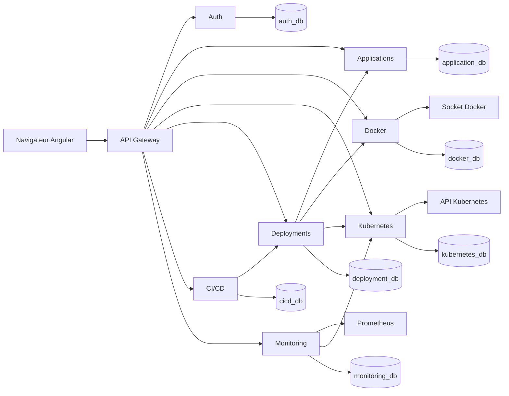

# Architecture microservices

Chaque service est un projet Maven indépendant, avec sa base MySQL, son API et son image. Le parent `pom.xml` ne fait que gérer les versions et l'agrégation. Il n'existe pas d'application Spring Boot unique.

## Frontières

| Service | Données | Responsabilité |
| --- | --- | --- |
| api-gateway | aucune | JWT, CORS, routage. N'expose pas `/internal`. Retire `X-Internal-Token` venant du navigateur. |
| auth-service | utilisateurs, rôles, jetons de rafraîchissement, notifications, audit d'authentification | Émission JWT, BCrypt |
| application-service | applications, variables chiffrées, historique | Dépôts GitHub autorisés |
| docker-service | builds, images gérées | Clone JGit, build via l'API Docker, tests dans un conteneur à commande fixe |
| kubernetes-service | journal des opérations | Client Fabric8, namespace `dcp`, RBAC limité |
| deployment-service | déploiements et révisions | Orchestre build puis déploiement, rollback par image précédente |
| cicd-service | pipelines, étapes, webhooks | Mode local réel, ou dispatch GitHub si un jeton est configuré |
| monitoring-service | cibles de surveillance | Requêtes Prometheus fixées côté serveur |

Les appels entre services passent par `InternalRestClient` : jeton interne, coupe-circuit Resilience4j, deux tentatives sur les erreurs réseau. Aucun service ne lit les tables d'un autre.

Dans Compose et dans Kubernetes, la découverte est le DNS des services (`http://auth-service:8081`). Il n'y a pas d'Eureka.

## Sécurité

- Mots de passe BCrypt, jetons de rafraîchissement stockés en SHA-256.
- Variables d'application chiffrées avec AES-GCM. La clé vient de `ENV_ENCRYPTION_KEY`. Les variables secrètes ne sortent jamais en clair sur les routes utilisateur.
- Dépôts limités à `https://github.com/{org}/{repo}`.
- Images limitées au préfixe `dcp/`, registre optionnel dans une liste autorisée.
- Aucune commande shell fournie par l'utilisateur. Les tests Maven ou npm utilisent un tableau d'arguments fixe.
- Le socket Docker n'est monté que dans `docker-service`.
- Le profil `prod` refuse les secrets qui commencent par `dev-only-`.
- Les fichiers d'exemple ne contiennent pas de secret de production. `.env` est ignoré par Git.

## Ce qui n'est pas encore un cluster

Le 11 octobre 2026 à 17:06, `kubectl` n'avait aucun contexte. Minikube, kind et k3d ne sont pas installés. Docker Desktop Kubernetes n'a pas été activé : environ 4,7 Go de RAM libre et 44 conteneurs déjà lancés dans une VM Docker de 16 Go. Les lectures Kubernetes répondent que le cluster est injoignable. Prometheus, lui, scrape les huit endpoints Actuator ; les graphiques Grafana utilisent ces séries, pas des métriques de Pods.
