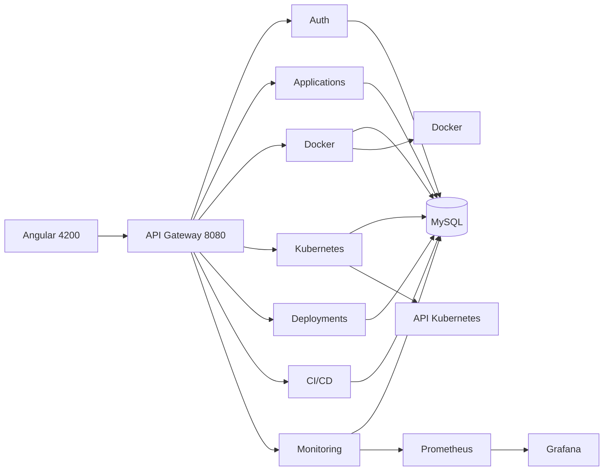

# Architecture

Huit processus Spring Boot. La passerelle est le seul point d'entrée du navigateur. Chaque service métier a sa base MySQL. Prometheus interroge `/actuator/prometheus`. Kubernetes n'est appelé que par `kubernetes-service`, et seulement si un cluster répond.

